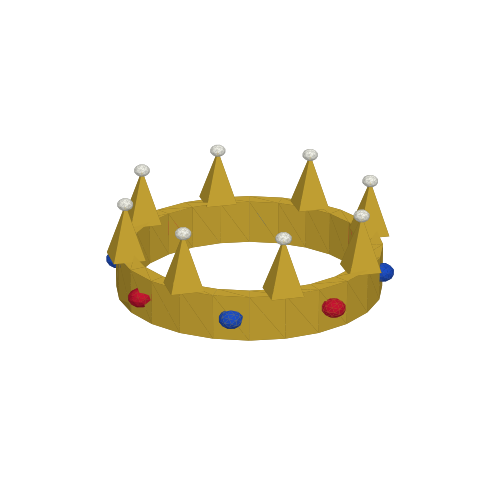

# Reverse engineering Customuse & AI text-to-3D

**Questions:** What does [customuse.com](https://customuse.com/) use to make 3D models? What's inside Tripo, Meshy and Hunyuan? Can I get the same results for free, and why can't Claude or ChatGPT just make the 3D model?

## TL;DR

1. **Customuse doesn't have its own 3D model.** It's a workflow layer on top of other companies' generators. Its own pages list Meshy, Tripo and Tencent Hunyuan as interchangeable 3D "nodes," next to image models from OpenAI, Google, FLUX, Kling and ByteDance ([Customuse vs Meshy](https://customuse.com/learn/customuse-vs-meshy), [homepage](https://customuse.com/)). What it adds is the Roblox-specific part: asset categories, fitting, triangle limits and export to Roblox Studio.
2. **"Text-to-3D" is almost always two models chained together:** text → **image** → **3D mesh**, plus a texture-painting step. Tencent's own source code shows this (see below).
3. **The image-to-3D step has free, open-weight versions you can run yourself:** Microsoft **TRELLIS.2** (MIT), Tencent **Hunyuan3D-2 / 2.1** (open but region-restricted), and VAST/Tripo's **TripoSG** (MIT). Pair one with a free text-to-image model and you have the whole stack. `pipeline/text_to_3d.py` does exactly that.
4. **Claude and ChatGPT are text models.** They can't output a sculpted, textured mesh, but they *can* write code that builds one. That works well for simple hard-surface items and badly for organic shapes. `llm_modeling/crown.py` is a working example.

## 1. Customuse: what's under the hood

| Evidence | What it shows |
|---|---|
| Customuse "learn" pages ([vs Meshy](https://customuse.com/learn/customuse-vs-meshy), [Meshy vs Tripo vs Customuse](https://customuse.com/learn/meshy-vs-tripo-vs-customuse), [3D AI Studio alternatives](https://customuse.com/learn/3d-ai-studio-alternatives)) | Describes itself as a multi-model workspace with Meshy, Tripo and Hunyuan as 3D nodes and OpenAI/Google/FLUX/Kling/ByteDance as image/video nodes |
| [Homepage](https://customuse.com/) | Lists Meshy, Tencent Hunyuan and Tripo as available 3D models; claims 35M+ generations a month |
| [Roblox UGC guide](https://customuse.com/learn/create-roblox-ugc-items-with-ai-customuse) | Flow: pick asset category → prompt → preview silhouette (the 2D image stage) → generate mesh → resize/fit → export to Roblox Studio |
| [CB Insights](https://www.cbinsights.com/company/customuse) | London company founded in 2021; its older app listings describe a skin/clothing design editor for Roblox and Minecraft, from before it added AI |

**Live REA capture status:** I couldn't run it from this cloud session. The environment's network policy blocks `customuse.com` (proxy `403` on CONNECT), so every finding above comes from Customuse's own published pages. `rea/capture_customuse.sh` runs the REA capture on any machine that can reach the site: it opens Chrome with a debugging port, then runs REA's `inspect-web-page`, `analyze-web-bundle` and `observe-web-session` while you click Generate. I tested the script end to end against a local stand-in page, where REA correctly pulled out a `fetch()` to a provider endpoint. Expect Customuse's browser code to call **Customuse's own backend**, which then calls Meshy, Tripo or Hunyuan from its servers. The provider API keys never reach the browser, so the most a capture can show is model-picker names and Customuse's own API routes.

## 2. How text-to-3D actually works

```
"a viking helmet"
      │  text-to-image (FLUX, GPT-Image, HunyuanDiT, …), plus a hidden prompt
      ▼  like "single object, white background, 3/4 view"
 reference image ──► background removal
      │
      ▼  image-to-shape: a diffusion/flow transformer that generates a 3D latent,
      │  then a 3D VAE decodes it to an SDF/voxel field → marching cubes → mesh
 untextured mesh ──► cleanup + decimation (polygon budget)
      │
      ▼  texture model: renders the mesh from many views, paints them with
      │  multi-view diffusion and projects the result back onto a UV texture
 textured .glb
```

**Proof from Hunyuan's code.** In Tencent's [`api_server.py`](https://github.com/Tencent-Hunyuan/Hunyuan3D-2/blob/main/api_server.py), a `"text"` request runs `HunyuanDiTPipeline` (a text-to-image model) to make an image, then sends that image through the normal image-to-3D path. So Hunyuan's "text-to-3D" is just text-to-image in front of image-to-3D.

**Tripo.** VAST, Tripo's maker, open-sourced its shape stack as [TripoSG](https://github.com/VAST-AI-Research/TripoSG): a rectified-flow transformer plus an SDF VAE trained on about 2M image–SDF pairs. Its paid product almost certainly runs newer, larger versions of the same design.

**Meshy.** Fully closed. Nothing is published about its internals, and its outputs and features (text → concept image → mesh → texture → remesh) fit the same pipeline.

**About "reverse engineering them for free":** Meshy, Tripo and hosted Hunyuan run their models on their own GPUs. There are no weights in the app or the website to extract. Reverse engineering their web clients only gets you the API calls, and those still bill your account. The real free route is the **open weights** the same companies and labs have published. I didn't try to get around anyone's billing.

## 3. Free / open alternatives

| Model | Who | License | GPU needed | Notes |
|---|---|---|---|---|
| [TRELLIS.2-4B](https://github.com/microsoft/TRELLIS.2) | Microsoft | **MIT** | ≥24 GB (A100/H100 tested), Linux | Best open quality in most 2026 comparisons; full PBR materials; ~17 s at 1024³ on H100 |
| [Hunyuan3D-2 / 2mini](https://github.com/Tencent-Hunyuan/Hunyuan3D-2) | Tencent | Tencent Hunyuan 3D Community License, **not valid in the EU, UK or South Korea** | ~6 GB shape, ~16 GB with texture | Best tooling: Gradio app, API server, Blender add-on; 0.6B "mini-turbo" runs fast |
| [Hunyuan3D-2.1](https://github.com/Tencent-Hunyuan/Hunyuan3D-2.1) | Tencent | Same license and region limits | ~10 GB shape, ~29 GB shape + PBR texture | Adds PBR texture over 2.0 |
| [TripoSG](https://github.com/VAST-AI-Research/TripoSG) | VAST (Tripo) | **MIT** | ≥8 GB | Shape only (no texture); has a `--faces` flag for low-poly output |

**No GPU?** TRELLIS.2, Hunyuan3D-2 and TripoSG all have Hugging Face Space demos that run free within a daily GPU quota, and Google Colab's free T4 (16 GB) can run Hunyuan3D-2mini. Renting a cloud GPU costs well under $1/hour, which works out to fractions of a cent per model compared with per-credit pricing.

**Why Meshy/Tripo results can look bad, and how to do better:** most of the quality comes from the **input image**. A blurry, cropped, or busy concept image gives a lumpy mesh. To get better results:
- Use a strong image model for stage 1 (ChatGPT's image generator or FLUX), and ask for a single object, a clean ¾ view and a plain background.
- Use TRELLIS.2 at 1024³ for shape.
- Decimate to your polygon budget last.

## 4. Why can't Claude or ChatGPT just do it?

- **They're trained to output text (and, for ChatGPT, 2D images), not 3D.** Generating a mesh needs a model trained on hundreds of thousands to millions of 3D objects that has learned a 3D latent space, like the shape transformers above. LLMs don't have one.
- **They can write code that builds geometry**, such as Blender Python, OpenSCAD, three.js or trimesh. `llm_modeling/crown.py` is a Roblox crown accessory written entirely as code. It renders, exports a valid `.glb`, and has 1,536 triangles (Roblox's accessory limit is 4,000):

  

  This works for **hard-surface, symmetric, primitive-built** things like weapons, furniture, crowns, buildings and low-poly props. It breaks down for **organic shapes** (creatures, faces, cloth) and for **painted textures**, which is what diffusion-based 3D models are for.
- **The best setup combines both.** Use the LLM as a director: it writes the image prompt, judges the reference image, and generates Blender cleanup and Roblox-export scripts. The open 3D models do the sculpting.

## Repo layout

| Path | What it is |
|---|---|
| `pipeline/text_to_3d.py` | Free local text → image (FLUX.1-schnell, Apache-2.0) → 3D (Hunyuan3D-2) pipeline, with cleanup and decimation to a face budget (default 4000 for Roblox). **Written against the upstream APIs but not run here (no GPU in this environment).** |
| `llm_modeling/crown.py` | Claude-written procedural 3D model → `crown.glb` + `crown_preview.png` (`pip install trimesh matplotlib`) |
| `rea/capture_customuse.sh` | REA passive capture of customuse.com (page, JS bundle endpoints, live session while you press Generate) |

Hunyuan3D is under the Tencent Hunyuan 3D Community License. If you're in the EU, UK or South Korea, use TRELLIS.2 or TripoSG for the image-to-3D step instead.
