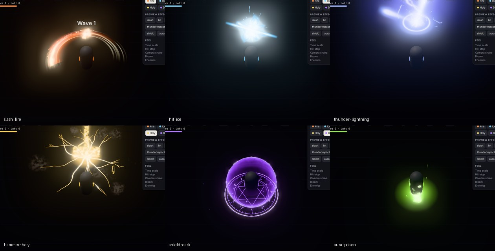

# combat-vfx

Stylized combat VFX for three.js, rebuilt from scratch after studying how the
[hun0fx combat VFX web demo](https://hun0fx.itch.io/combat-vfx-demo) works (see [ANALYSIS.md](ANALYSIS.md)).
Everything here is original: textures and meshes are generated procedurally at startup, so there are no asset
files and nothing from the original pack.



- **8 effects**: `slash`, `hit`, `thunder` + `thunderImpact`, `hammer` (from the sky), `shield`, `aura`, `dust`
- **6 elements** for every effect: fire, ice, lightning, holy, dark, poison (palette swap + an element signature layer)
- **Game-feel helpers**: trauma camera shake, hit-stop, hit flash
- One draw call per layer, deterministic fixed-step simulation, HDR bloom

## Run the playground

```bash
cd combat-vfx
python3 -m http.server 8080     # any static server; three.js loads from jsDelivr
# open http://localhost:8080
```

WASD move · click / J swing · E thunder · F hammer · Shift dash · G shield · Q aura · 1–6 element · wheel zoom.
The panel previews any effect and toggles hit-stop, shake, bloom and enemies.

## Use it in a game

```js
import { VFX, CameraShake, HitStop, createPost } from './combat-vfx/src/index.js';

const vfx = new VFX(scene, { element: 'fire' });
const post = createPost(renderer, scene, camera);     // bloom on HDR > 1 + Neutral tone mapping

// on attack
vfx.play('slash', { position: hero.position.clone().setY(1.1), direction: heroForward, roll: backhand ? 180 : 0 });
vfx.play('hit', { position: enemyChest, direction: hitDir, element: 'ice' });
const shield = vfx.play('shield', { parent: hero, position: [0, 0, 0] });   // loops
shield.stop();                                                             // plays its outro, then frees itself

// every frame
vfx.update(dt);          // pass 0 (or HitStop.scale(dt)) to freeze effects during a hit-stop
post.render();
```

`play()` options: `position`, `direction` (the effect's +Z turns toward it), `yaw` / `pitch` / `roll` (degrees),
`element`, `parent`, `intensity`, `tempo`, `scale`, `seed`, `autoDispose`.
Each recipe also has `place` metadata: `chest`, `target`, `ground`, `feet` or `attach`.
`RECIPES.hammer.impactAt` (0.45 s) is when to apply damage and shake.

Requires three.js r163+ (`NeutralToneMapping`). The library uses `three` and `three/addons/` imports, so
map them with an import map (see `index.html`) or a bundler.

## Writing effects

An effect is a list of layers. Each layer is one emitter, drawn as one instanced mesh. Recipes receive the element
palette `E = { core, main, deep }` (linear RGB):

```js
import { curve } from './combat-vfx/src/index.js';

const myBurst = {
  name: 'myBurst',
  layers: (E) => [{
    name: 'Ring', render: 'flat', texture: 'ring', rotation: [-90, 0, 0],
    bursts: [[0, 1]], life: 0.4, size: 5, sizeOverLife: [[0, 0.2], [1, 1]],
    color: E.main, alpha: [[0, 1], [1, 0]], glow: [[0, 2], [1, 0]],
  }],
};
vfx.play(myBurst, { position });
```

**Value specs** (`life`, `speed`, `size`, `angle`, `spin`, `rate`, `delay`): a number, `[min, max]` (random per
particle) or `curve(points, scale)`. **Over-life curves** (`sizeOverLife`, `alpha`, `dissolve`, `scroll`, `glow`) are
point lists `[[t, v], ...]` over normalized age.

| Field | Meaning |
| --- | --- |
| `render` | `billboard` (faces camera) · `stretched` (along velocity) · `axial` (stands on +Y, turns to camera) · `mesh` · `flat` (oriented quad) |
| `mesh` | for `render: 'mesh'`: `arc` (crescent), `cylinder`, `flare`, `sphere` |
| `texture` | `glow` `soft` `solid` `spark` `ring` `slash` `streak` `line` `pillar` `burst` `star` `shard` `bubble` `smoke` `lightning` `crack` `rune` `hammer` `rock` |
| `frames` | flipbook `{ cols, rows, fps?, random? }` (`smoke`, `rock`: 2×2; `lightning`: 4×1) |
| `blend` | `add` (default) or `alpha` |
| `delay`, `duration`, `loop` | emitter timing (duration defaults to the last burst, or 1 s with a rate) |
| `bursts`, `rate`, `max` | `[[time, count], ...]`, particles per second, capacity (default 64) |
| `shape` | `point` · `sphere` · `hemisphere` · `circle` (`arc`, `edge`, `tangent`) · `cone` (`axis`, `angle`) · `box`, plus `radius`, `offset` |
| `velocity`, `gravity`, `drag` | constant velocity added at birth, gravity in g, exponential drag per second |
| `size`, `aspect`, `pivot` | uniform size, per-axis multiplier, quad pivot offset |
| `angle`, `spin`, `spinAxis` | start angle (deg), angular velocity (deg/s), axis for mesh/flat |
| `position`, `rotation` | the layer's own offset and orientation (rotation also turns its motion) |
| `color`, `colorOverLife`, `alpha`, `opacity` | linear RGB (may exceed 1), gradient `[[t, rgb], ...]`, alpha curve |
| `hot`, `hotColor`, `intensity` | two-tone ramp: dense parts go `hotColor` (default `E.core`) between `hot: [lo, hi]`; `false` disables |
| `dissolve`, `soft`, `noise`, `noiseScale`, `noisePan` | noise threshold over life (−1 intact → 1 gone), edge softness, noise breakup |
| `scroll`, `scrollAxis`, `pan`, `swapUV` | per-particle UV scroll over life, constant UV pan per second, swap U/V |
| `glow` | intensity boost over life (values that push color above 1 bloom) |
| `edgeFade`, `fresnel`, `groundFade`, `fieldFromG`, `shade` | UV edge fades `[u0, u1, v0, v1]`, rim power, fade toward y = 0, reveal by the texture's `.g`, shade by `.r` |
| `sustain` | hold particles at this fraction of life until `stop()`, then play the rest (intro / loop / outro) |
| `stretch`, `velStretch` | stretched length = size × stretch + speed × velStretch |

## Tests

```bash
npm install      # three + playwright-core (dev only)
npm test         # unit tests for the simulation core (Node, no browser)
npm run smoke    # headless Chromium: plays every effect in every element, fails on any console/shader error,
                 # writes screenshots to smoke-out/
```

## License

MIT for the code in this directory. The original hun0fx effects and textures are **not** included and remain the
author's. Their demo states they "may not be reused or redistributed".
